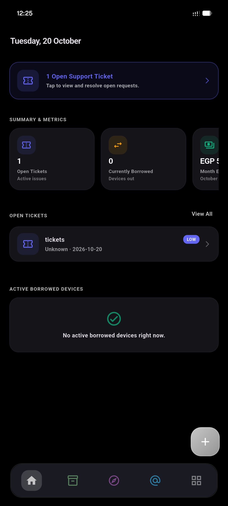
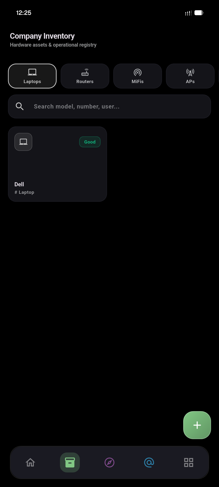
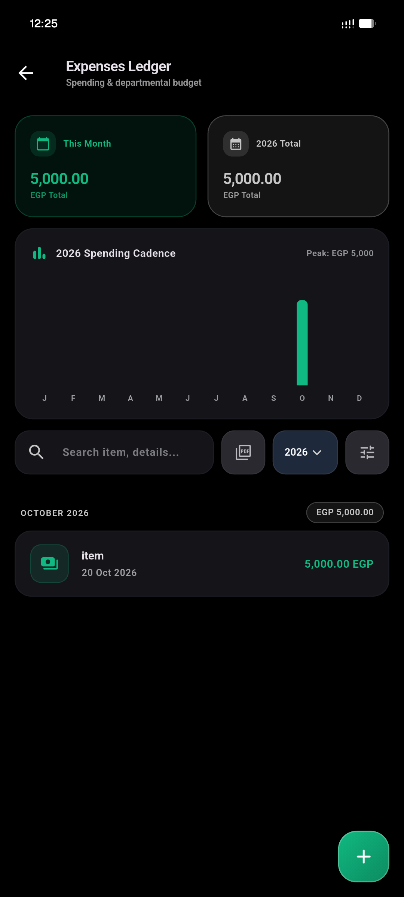
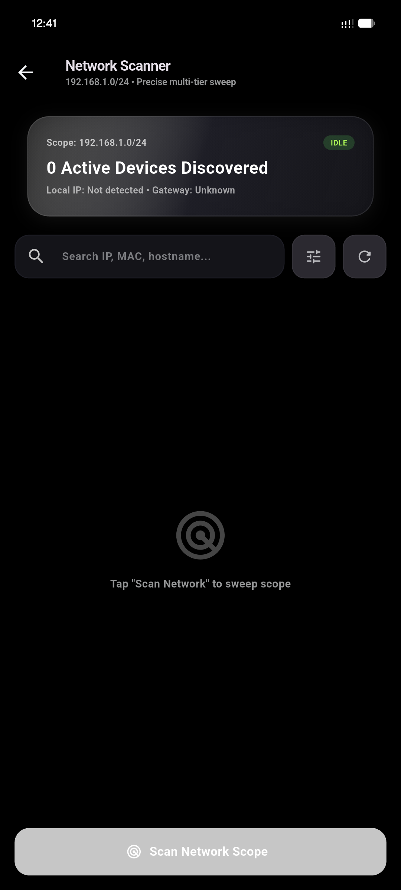
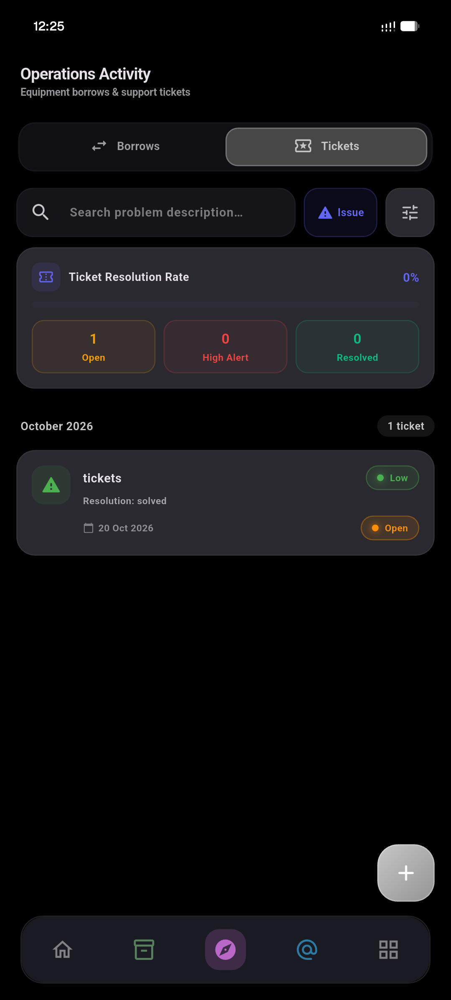
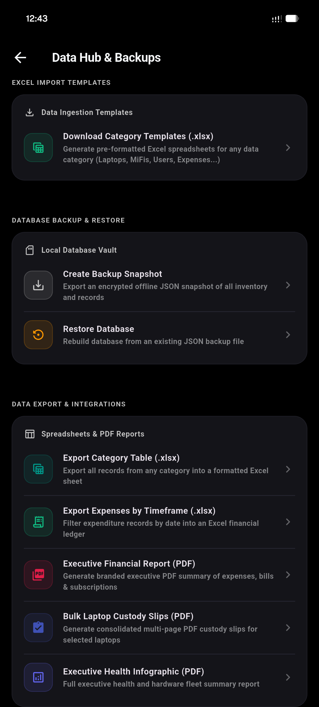
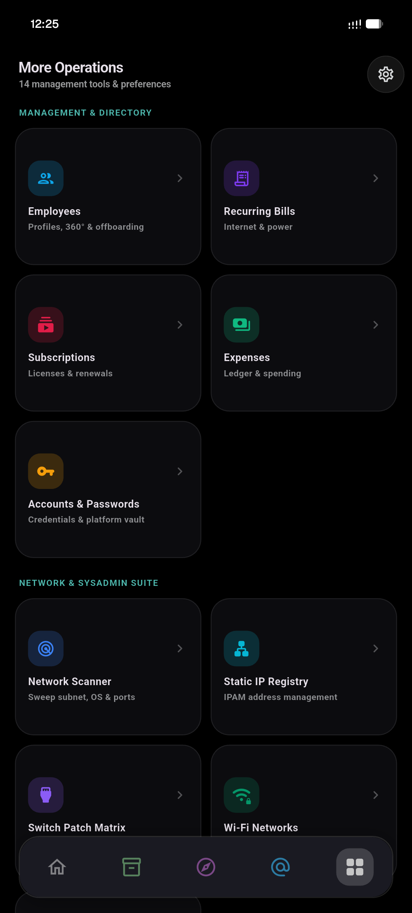

<div align="center">


# IT Box

[](https://android.com) [](https://flutter.dev) [](https://github.com/mina-android/IT-Box/releases) [](LICENSE)

<p align="center">
  A local-first offline inventory manager, subnet calculator, and network diagnostics toolkit designed for system administrators, network engineers, and IT departments.
</p>

</div>

---

## Navigation

[Features](#features) &bull; [Screenshots](#screenshots) &bull; [Downloads](#downloads) &bull; [Self Building & Local Setup](#self-building--local-setup) &bull; [Frequently Asked Questions](#frequently-asked-questions) &bull; [Contribution](#contribution) &bull; [About the Developer](#about-the-developer) &bull; [Donate](#donate) &bull; [License](#license)

---

## Features

### Core Capabilities

- **Hardware Asset & Peripheral Inventory**: Manage computers, network appliances, monitors, and peripherals with serial numbers, warranty terms, asset tags, and location assignments.
- **Barcode & QR Asset Auditing**: Scan 1D barcodes and 2D QR codes using the device camera for hardware lookup, check-out assignment, and field auditing.
- **Subnet & CIDR Range Calculator**: Real-time IPv4 address calculation computing subnet masks, CIDR prefixes, wildcard masks, usable host ranges, and broadcast boundaries.
- **Local Network Discovery Scanner**: Discovers active hosts across connected subnets using ARP and ICMP requests, identifying open ports, MAC addresses, and vendor OUIs.
- **Cisco Configuration File Parser**: Ingests raw Cisco IOS `.cfg` and `.txt` configuration dumps, parsing interfaces, IP allocations, VLAN tagging, and switchport states into searchable structures.
- **Server Rack Unit Visualizer**: Interactive rack layout designer (1U through 42U) for visualizing physical server deployments and patch panel port routes.
- **Multi-Organization Isolation**: Create and hot-switch between multiple organizations in System Settings, each with its own isolated SQLite database, organization name, and logo without restarting or losing data.
- **Multi-Currency & Exchange Rates**: Select from 62 world currencies with live exchange rate retrieval (`open.er-api.com` + offline fallback) and optional atomic conversion of financial ledgers.
- **Custody & Borrow Management**: Logs borrowed equipment with checkout dates, expected return deadlines, borrower departments, sorting options, and overdue alerts.

### Architecture & Data Handling

- **Offline-Only Infrastructure**: All asset inventories, device scans, and network calculations run directly on the client machine. The software requires no external database server, SaaS backend, or active internet connection.
- **Local Storage Engine**: Persists operational state and inventories in an SQLite database stored inside application sandbox storage.
- **Vector Document Export**: Directly generates printable, vector-rendered PDF reports for equipment sign-outs, inventory audits, and rack layouts.

---

## Screenshots

<table width="100%" border="0" cellspacing="0" cellpadding="4">
  <tr>
    <td width="33.33%" align="center" valign="top">
      
    </td>
    <td width="33.33%" align="center" valign="top">
      
    </td>
    <td width="33.33%" align="center" valign="top">
      
    </td>
  </tr>
  <tr>
    <td width="33.33%" align="center" valign="top">
      
    </td>
    <td width="33.33%" align="center" valign="top">
      
    </td>
    <td width="33.33%" align="center" valign="top">
      
    </td>
  </tr>
  <tr>
    <td width="33.33%" align="center" valign="top">
      
    </td>
    <td width="33.33%" align="center" valign="top">
      
    </td>
    <td width="33.33%" align="center" valign="top">
      
    </td>
  </tr>
</table>

---

## Downloads

Official release packages are published under the [GitHub Releases](https://github.com/mina-android/IT-Box/releases) section.

| Platform | Architecture | Package Type | Download Link | Notes |
| :--- | :--- | :--- | :--- | :--- |
| **Android** | arm64-v8a | `.apk` | [Download (v1.1.0)](https://github.com/mina-android/IT-Box/releases/latest) | 64-bit devices (recommended) |
| **Android** | armeabi-v7a | `.apk` | [Download (v1.1.0)](https://github.com/mina-android/IT-Box/releases/latest) | 32-bit legacy hardware |
| **Android** | x86_64 | `.apk` | [Download (v1.1.0)](https://github.com/mina-android/IT-Box/releases/latest) | Emulators and Intel-based tablets |
| **Android** | Universal | `.apk` | [Download (v1.1.0)](https://github.com/mina-android/IT-Box/releases/latest) | All-in-one distribution binary |

---

## Self Building & Local Setup

### 1. Prerequisites

Ensure the following tools are installed on your build machine:

- **Flutter SDK**: `3.22.0` or higher
- **Dart SDK**: `3.4.0` or higher
- **Android SDK**: API level `34`
- **Java Development Kit**: OpenJDK `17`
- **Git**: `2.30+`

### 2. Repository Setup

```bash
# Clone the repository
git clone https://github.com/mina-android/IT-Box.git

# Navigate into the project root
cd IT-Box

# Verify Flutter installation
flutter doctor
```

### 3. Dependency Installation

```bash
# Retrieve dependencies
flutter pub get
```

### 4. Build Compilation

```bash
# Build optimized release binaries
flutter build apk --split-per-abi --release
```

Generated APKs will be located in `build/app/outputs/flutter-apk/`.

### 5. Running the Application Locally

```bash
flutter run --release
```

---

## Frequently Asked Questions

#### Does the network scanner require root permissions on Android?
No root permissions are necessary. The scanner uses standard ICMP ping commands and ARP cache lookups accessible through non-root Android application permissions.

#### Can I export and import asset records?
Yes. IT Box includes tools to export the entire hardware inventory database to Excel (.xlsx) and JSON formats. Backups can be restored at any time via Settings > Data Management.

#### How does the Cisco config parser work?
The parser operates as an entirely local text analyzer running on the device. It matches standard Cisco IOS syntax patterns to extract interfaces, IP assignments, VLAN IDs, and duplex settings without sending configuration files to any remote server.

---

## Contribution

Contributions aimed at improving subnet math accuracy, parser features, or UI performance are welcome.

### Contribution Process

1. Review existing issues to confirm your proposed change is not already in development.
2. For major additions (e.g. IPv6 support or new parser types), open a design discussion issue first.
3. Validate code formatting and tests:
   ```bash
   flutter analyze
   flutter test
   ```
4. Open a Pull Request referencing related tickets.

---

## About the Developer

This project is authored and maintained by **mina-android**, building specialized offline utilities and cross-platform mobile software.

- **Developer Portfolio**: [portfolio.minaashraf285.workers.dev](https://portfolio.minaashraf285.workers.dev/)
- **GitHub Profile**: [github.com/mina-android](https://github.com/mina-android)
- **Issue Tracker**: [github.com/mina-android/IT-Box/issues](https://github.com/mina-android/IT-Box/issues)

---

## Donate

If IT Box improves your infrastructure administration or saves you operational time, your support helps maintain continuous development:

- **PayPal**: [paypal.me/minaashraf285](https://paypal.me/minaashraf285)
- **GitHub Sponsors**: [github.com/sponsors/mina-android](https://github.com/sponsors/mina-android)

---

## License

Distributed under the **GNU General Public License v3.0**. See the [`LICENSE`](LICENSE) file in the root directory for legal terms.

```text
Copyright (c) 2026 mina-android
Licensed under the GNU General Public License v3.0.
```
