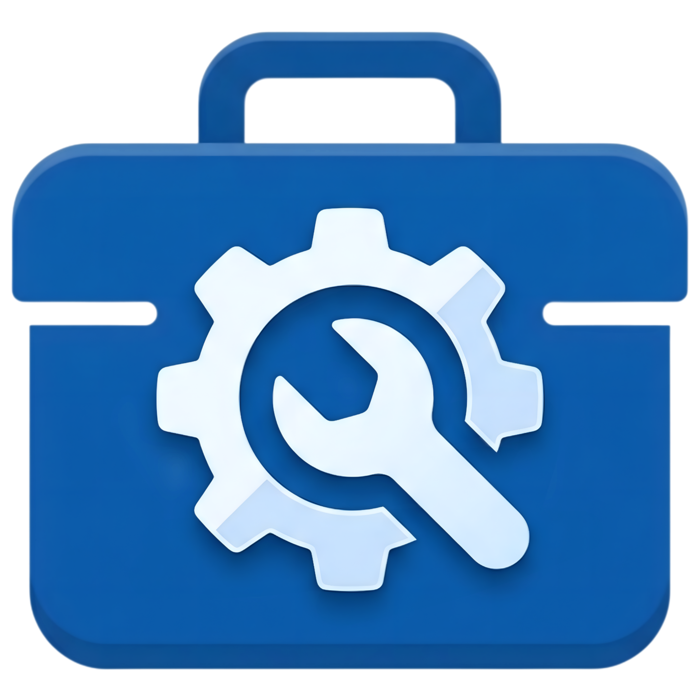
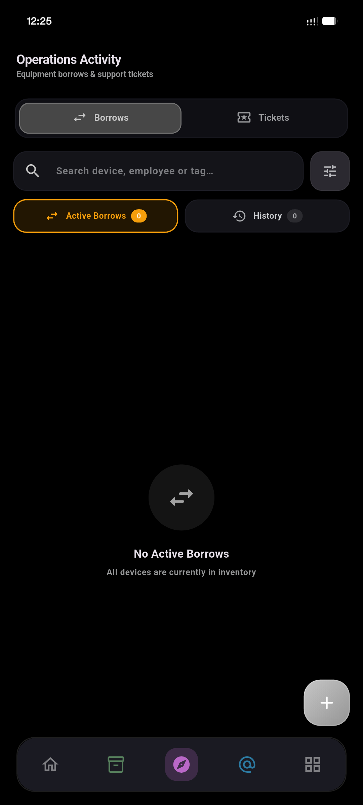

<div align="center">



<h1>IT Box</h1>

<h3>Your offline IT department inventory, operations, and asset management hub</h3>

[](https://android.com) [](https://github.com/mina-android/IT-Box/releases) [](LICENSE)

IT Box is a simple app that helps IT administrators and technical teams track hardware assets, manage borrowed gear, record department expenses, monitor software licenses, and generate instant executive reports.  
It works completely offline, with no sign-ups or ads, and your data never leaves your phone.

[**Download**](#-download) · [**Features**](#-what-you-can-do) · [**Screenshots**](#-take-a-look) · [**FAQ**](#-questions-you-might-have) · [**For Developers**](#-for-developers)

</div>

---

## ✨ What you can do

- **💻 Hardware & Peripheral Inventory**: Track Laptops, Routers, MiFis, Access Points, Printers, Electronics, and miscellaneous gear with specs, serial numbers, port maps, and assigned employees.
- **🌐 Precision Advanced IP Scanner**: Dual-engine subnet discovery (Windows Win32 `SendARP` via FFI + Android/Linux ICMP/ARP sweeps) with multi-protocol identity resolution (NetBIOS, mDNS, SSDP, LLMNR, HTTP headers), 100+ IEEE OUI vendor database, Wake-on-LAN, and 1-tap addition to inventory or static IPs.
- **🔄 Equipment Borrows & Overdue Alarms**: Hand equipment out to team members with automatic background overdue reminder alarms, active borrow tracking, and direct email app handoff.
- **📝 Digital Equipment Custody Slips (PDF)**: Generate official custody receipts with company branding, hardware specs, condition notes, and an on-screen digital signature pad for individual or bulk laptop handovers.
- **🏷️ Printable Asset Labels & QR Code Stickers**: Generate clean asset QR code stickers, 4-column equipment labels (with single-line switch/patch units), and print-ready Wi-Fi access cards.
- **📇 Dual-Format Wi-Fi Access Cards**: Export print-ready Wi-Fi access cards in two optimized layouts: **Standard Cards** (compacted borders fitting 3 cards per A4 sheet) and **Portable Cards** (dense 7cm × 4cm pocket cards fitting 20 cards per Landscape A4 sheet).
- **🎛️ Dynamic Switch & Patch Panel Matrix**: Interactive 8, 12, 16, 24, and 48-port switch and patch panel layouts with real-time port telemetry, connected host tags, and interactive port patch mapping.
- **👥 Employee 360° Dossier & Exit Checklist**: Comprehensive employee profile view showing assigned laptops, active equipment borrows, corporate emails, and trouble tickets, complete with guided onboarding/offboarding checklists.
- **🛠️ Per-Device Maintenance & Repair History**: Document hardware repairs, upgrades, and component replacements with technician notes, lifetime cost tracking, and direct expense ledger integration.
- **📶 Centralized Wi-Fi Networks Registry**: Aggregate Wi-Fi credentials across Routers, MiFis, and standalone networks (SSID, password, phone number, location, admin credentials) with quick search and reveal toggles.
- **🔐 Accounts & Passwords Vault**: Secure offline platform credentials repository (platform, email/username, password) with reveal toggles and 1-tap clipboard copying.
- **📊 Executive Infographics & Financial Ledgers**: Export one-page department health vector infographics, track expenses/bills with receipt image attachments, and perform two-way multi-table Excel (`.xlsx`) import and export.

---

## 🧭 Getting started

1. **Set your company identity**: On first launch, enter your company name or restore an existing backup file to initialize your local vault.
2. **Populate your directory**: Add employees, laptops, routers, and peripheral inventory with one tap.
3. **Log checkouts and operations**: Hand out equipment using the fast checkout flow, record IT troubleshooting tickets, or log department expenses.
4. **Export reports & labels**: Generate formatted PDF reports, custody slips, or print-ready physical asset barcode labels directly to any printer or share sheet.

---

## 📸 Take a look

<p align="center">
  
  
  
</p>

<p align="center">
  
  
  
</p>

<p align="center">
  
  
  
</p>

---

## 📲 Download

1. Head over to the [**Releases page**](https://github.com/mina-android/IT-Box/releases)
2. Grab the latest APK. If you're not sure which one, pick the file ending in `arm64-v8a`, since most newer phones use that
3. Open it, and if Android asks, allow installs from unknown sources

It runs on Android 8.0 (Oreo / API 26) or newer and takes up about 28 MB.

---

## 🔒 Your privacy

I take this seriously, so here's the plain version:

- **Everything stays on your phone**: All your records are stored locally using a high-performance SQLite database via Drift over Dart FFI in a background isolate (`itbox.db`) with foreign keys enabled.
- **No accounts, no ads, and no tracking**: No sign-up screens, no telemetry, no analytics SDKs, and zero cloud databases pinging external servers.
- **If you uninstall the app, your data goes with it**: Because nothing is stored remotely, make sure to save a backup to your storage or drive before changing phones or uninstalling.

---

## ❓ Questions you might have

**Do I need an internet connection to use it?**  
No. IT Box works entirely offline. Zero external network calls or remote internet permissions are used (local network scanning only operates on your local Wi-Fi subnet when explicitly triggered).

**What happens to my data if I get a new phone?**  
Go to More Hub -> System Settings, tap "Create Backup", and save the JSON backup file to your Google Drive or transfer it to your new phone. Once installed on the new phone, tap "Restore Backup".

**Can I import data from Excel spreadsheets?**  
Yes! Built-in support is provided for importing and exporting Excel (`.xlsx`) files for every single inventory category, employee list, bill, and expense log.

**Is there an iPhone version?**  
Not right now. IT Box is engineered specifically for Android with native Material You wallpaper theming, predictive back gestures, local overdue alarm scheduling, and high-performance offline SQLite.

---

## 💬 Say hello

- Ran into a bug or want a new feature? [Open an issue](https://github.com/mina-android/IT-Box/issues)
- Just want to chat or give feedback? Reach me via GitHub Issues or discussions
- If the app has made your life a little easier, a ⭐ on the repo would make my day

---

## 🛠 For developers

<details>
<summary><strong>What it's built with</strong></summary>

- **Flutter & Dart**: Flutter SDK `>=3.19.0` / Dart SDK `>=3.3.0 <4.0.0` targeting Android (minSdk 21, compileSdk 36).
- **Toolchain**: Gradle 9.3.1, AGP 9.1.0, Kotlin 2.4.0 with Core Desugaring 2.1.5.
- **Drift & SQLite**: Compile-time type-safe persistence executing in a dedicated background isolate via Drift & SQLite over Dart FFI (`itbox.db`, schema `v14`) with typed query builders, reactive streams (`.watch()`), and self-healing borrow synchronization.
- **State Architecture**: Zero-overhead `setState` + `async/await` design with native `StreamSubscription` for reactive Drift tables without third-party framework lock-in.
- **System Architecture**: Complete database ERD diagrams, lifecycle sequence charts, and data flow pipelines are documented in [`STRUCTURE.md`](STRUCTURE.md).
- **Key Packages**: `drift`, `sqlite3_flutter_libs`, `ffi`, `fl_chart`, `pdf`, `printing`, `excel`, `file_picker`, `share_plus`, `flutter_local_notifications`, `dynamic_color`, `google_fonts`, `shimmer`, `mobile_scanner`, `signature`.

</details>

<details>
<summary><strong>Run it yourself</strong></summary>

You'll need Flutter SDK and Java JDK 17+ (or Android Studio). Then:

```bash
git clone https://github.com/mina-android/IT-Box.git
cd IT-Box
flutter pub get
flutter run
```

To build release split-per-ABI APKs:
```bash
flutter build apk --split-per-abi
```
To run tests and code analyzer:
```bash
flutter test
flutter analyze
```

</details>

<details>
<summary><strong>Want to help out?</strong></summary>

Contributions are welcome! Here's how:

1. Fork the repo
2. Create a branch: `git checkout -b feature/my-new-feature`
3. Make your changes and push them
4. Open a Pull Request and tell me what you changed

Please run `flutter analyze` before opening a pull request to keep code quality and linting clean.

</details>

---

## 📄 License

Distributed under the GNU General Public License v3.0. Have a look at [LICENSE](LICENSE) for the details.  
Copyright © 2026 [Mina Android](https://github.com/mina-android)

<div align="center">

Made with ❤️ for IT administrators and operations teams · [**See my other projects**](https://github.com/mina-android)

</div>
