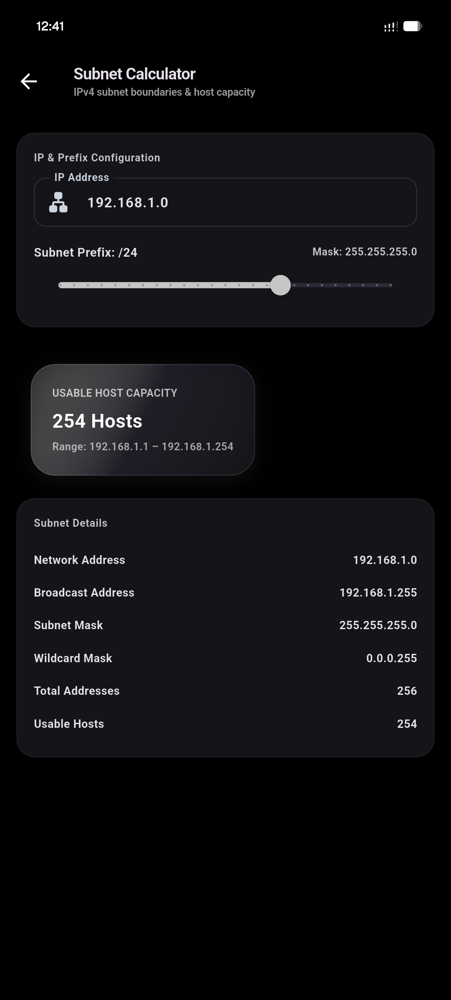

<div align="center">


# IT Box

[](https://developer.android.com) [](https://flutter.dev) [](https://github.com/mina-android/IT-Box/releases) [](LICENSE)

<p align="center">
  A local-first offline IT operations hub, hardware inventory manager, subnet calculator, and network diagnostics toolkit built with Flutter for system administrators, network engineers, and IT departments on Android.
</p>

</div>

---

## Navigation

[Features](#features) &bull; [Screenshots](#screenshots) &bull; [Downloads](#downloads) &bull; [Self Building & Local Setup](#self-building--local-setup) &bull; [Contribution](#contribution) &bull; [About the Developer](#about-the-developer) &bull; [Donate](#donate) &bull; [License](#license)

---

## Features

### Core Capabilities

- **Hardware Asset & Peripheral Inventory**: Manage laptops, routers, access points, printers, MiFis, electronics, and miscellaneous assets with serial numbers, asset tags, maintenance logs, and location assignments across a 23-table Drift SQLite schema (Schema v17).
- **Barcode & QR Asset Auditing**: Scan 1D barcodes and 2D QR codes with the device camera for instant asset lookup, checkout assignment, and printable asset label generation.
- **Subnet & CIDR Range Calculator**: Real-time IPv4 address calculation computing subnet masks, CIDR prefixes, wildcard masks, usable host ranges, and broadcast boundaries alongside an IPAM static IP registry.
- **Local Network Discovery & Diagnostics**: Discovers active hosts across local subnets using ARP and ICMP requests, and performs DNS lookups, TCP port probing with banner grabbing, and HTTP link throughput tests.
- **Custody Documents Hub**: Automatically archives custody PDFs generated from Borrowed and Laptops, and builds custom multi-item custody slips with dynamic specs, editable agreement text, digital signatures, and bulk consolidated multi-page PDF export.
- **Documents Vault & On-Device Scanner**: Scans physical contracts, warranties, invoices, and signed paperwork using on-device ML Kit document scanning (`google_mlkit_document_scanner`) or file import, with employee/asset tagging and an embedded in-app PDF and zoomable image viewer.
- **Server Rack & Switch Patch Matrix**: Visualizes 24-port and 48-port switch patch panels and port-to-endpoint mappings with full-screen port editing and custom chassis support.
- **Multi-Organization Isolation**: Creates and hot-switches between isolated organizations in Settings, each with its own SQLite database (`itbox.db`, `itbox_org_<id>.db`), name, logo, currency, and backup scope without restarting.
- **Multi-Currency & Financial Ledgers**: Tracks IT expenses (with receipt attachments), recurring utility bills, and SaaS subscriptions across 62 world currencies with optional live exchange rate conversion (`open.er-api.com` + offline fallback).
- **Custody, Borrows & Ticket Reminders**: Tracks equipment checkouts with due dates, optional notes, overdue alarms, unified filter/sort sheets, and configurable weekly weekday and manual clock-time ticket logging reminders (`TicketReminderService`).
- **Encrypted SAF & Scheduled Backups**: Executes scheduled 02:00 AM WorkManager snapshots to Android Storage Access Framework (SAF) folders with optional Android Keystore encryption, selective table backup/restore, Base64 Vault and receipt file embedding, AES-256-GCM `.itbox.enc` vaults, and Pre-Restore Undo safety snapshots.

### Architecture & Data Handling

- **Local-First Architecture**: All asset inventories, device scans, documents, and calculations remain localized to Android application sandbox storage using SQLite (`itbox.db` via Drift on a background isolate). No external account registration or cloud database is required.
- **Zero Outbound Telemetry**: No diagnostic events, usage metrics, or personal data are transmitted across the network. Outbound requests occur only when the user explicitly triggers an exchange rate refresh (`open.er-api.com`) or runs an HTTP/DNS diagnostic probe.
- **Resource Footprint**: Minimal background CPU and storage overhead, using reactive Drift `.watch()` streams with no third-party state management overhead and hardware-accelerated PDF/Excel generation in isolates.

---

## Screenshots

<table width="100%" border="0" cellspacing="0" cellpadding="4">
  <tr>
    <td width="33.33%" align="center" valign="top">
      
    </td>
    <td width="33.33%" align="center" valign="top">
      
    </td>
    <td width="33.33%" align="center" valign="top">
      
    </td>
  </tr>
  <tr>
    <td width="33.33%" align="center" valign="top">
      
    </td>
    <td width="33.33%" align="center" valign="top">
      
    </td>
    <td width="33.33%" align="center" valign="top">
      
    </td>
  </tr>
  <tr>
    <td width="33.33%" align="center" valign="top">
      
    </td>
    <td width="33.33%" align="center" valign="top">
      
    </td>
    <td width="33.33%" align="center" valign="top">
      
    </td>
  </tr>
</table>

---

## Downloads

Official release packages are published under the [GitHub Releases](https://github.com/mina-android/IT-Box/releases) repository page.

| Platform | Architecture | Package Type | Download Link | Notes |
| :--- | :--- | :--- | :--- | :--- |
| **Android** | arm64-v8a | `.apk` | [Download (v1.2.0)](https://github.com/mina-android/IT-Box/releases/latest) | Modern 64-bit devices (recommended) |
| **Android** | armeabi-v7a | `.apk` | [Download (v1.2.0)](https://github.com/mina-android/IT-Box/releases/latest) | Legacy 32-bit devices |
| **Android** | x86_64 | `.apk` | [Download (v1.2.0)](https://github.com/mina-android/IT-Box/releases/latest) | Android emulators and Intel-based tablets |
| **Android** | Universal | `.apk` | [Download (v1.2.0)](https://github.com/mina-android/IT-Box/releases/latest) | Combined installer supporting all architectures |

---

## Self Building & Local Setup

### 1. Prerequisites

Ensure your development environment has the following software installed:

- **Flutter SDK**: `3.22.0` or higher (tested with `3.47.6`)
- **Dart SDK**: `3.3.0` or higher
- **Android SDK**: API level `34` or higher (`minSdk 31`)
- **Java Development Kit**: OpenJDK `17`
- **Git**: `2.30+`

### 2. Repository Setup

```bash
# Clone the repository
git clone https://github.com/mina-android/IT-Box.git

# Navigate into the project root
cd IT-Box

# Verify Flutter environment
flutter doctor
```

### 3. Dependency Installation

```bash
# Fetch required dependencies
flutter pub get
```

### 4. Build Compilation

```bash
# Compile split APKs per ABI (recommended for distribution)
flutter build apk --split-per-abi

# Or compile a single universal release APK
flutter build apk
```

Compiled binaries will be generated inside `build/app/outputs/flutter-apk/`.

### 5. Running the Application Locally

```bash
# Connect a target Android device or emulator, then execute
flutter run --release
```

---

## Contribution

Contributions that improve stability, fix reproducible bugs, or improve documentation are welcome.

### Contribution Process

1. **Check Issues**: Review existing GitHub Issues to verify whether a problem or enhancement is already documented.
2. **Open a Discussion**: For substantial structural or architectural alterations, open an issue first to discuss the design.
3. **Branching**: Branch off `main` using descriptive branch names (`fix/issue-description` or `feat/feature-name`).
4. **Code Quality**:
   - Ensure code passes static analysis and formatting: `flutter analyze`
   - Run unit and widget/integration tests: `flutter test`
5. **Pull Request**: Open a pull request against `main` providing a clear breakdown of changes and relevant issue links.

---

## About the Developer

This project is authored and maintained by **mina-android**, focused on developing transparent, local-first utilities and privacy-conscious software.

[](https://portfolio.minaashraf285.workers.dev/) [](https://github.com/mina-android) [](https://github.com/mina-android/IT-Box/issues)

---

## Donate

Development and maintenance of this software are independent and self-supported. If this project helps you in your workflow, consider supporting development:

[](https://paypal.me/minaashraf285) [](https://github.com/sponsors/mina-android) [](https://ko-fi.com/minaashraf285)

---

## License

Distributed under the **GNU General Public License v3.0**. See the [`LICENSE`](LICENSE) file in the root directory for the complete legal text.

```text
Copyright (c) 2026 mina-android
Licensed under the GNU General Public License v3.0.
```
