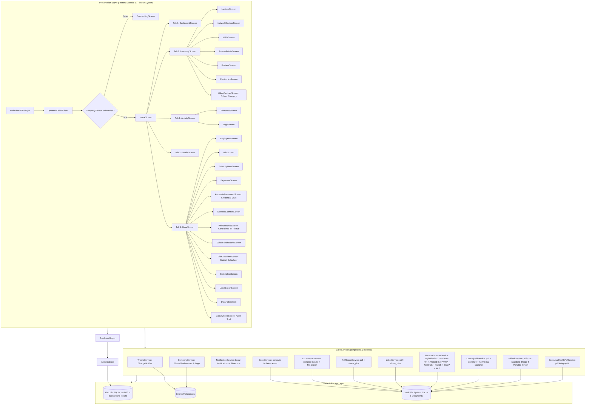
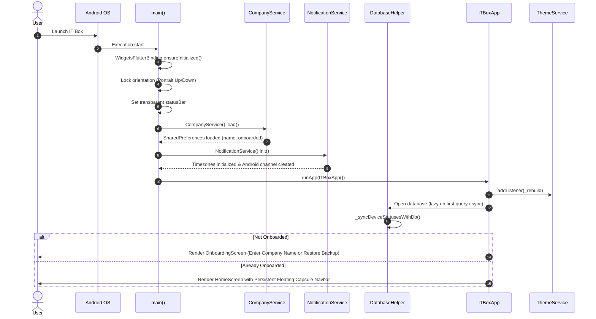
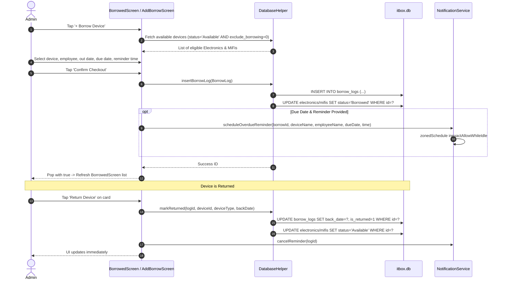

# Project Structure & Architecture — IT Box

Comprehensive structural, architectural, and data-flow reference manual for the IT Box project.

---

## 1. System Architecture Overview

IT Box is an offline-first IT department inventory, operations, and asset management application built with Flutter, targeting Android devices (phones, tablets, and emulators).



---

## 2. Database Schema & Entity Relationship Diagram (ERD)

The database engine is SQLite managed via **Drift** (`AppDatabase.instance`) over Dart FFI in a dedicated background isolate, with `DatabaseHelper` acting as a singleton facade using compile-time typed query builders and reactive streams (`.watch()`). Foreign keys are enforced via `PRAGMA foreign_keys = ON`. Current schema version is **14**.

```mermaid
erDiagram
    EMPLOYEES ||--o{ BORROW_LOGS : "borrows"
    EMPLOYEES ||--o{ EMAIL_ACCOUNTS : "owns"
    EMPLOYEES ||--o{ LOG_ENTRIES : "reports"
    ELECTRONICS ||--o{ BORROW_LOGS : "checked out as electronic"
    MIFIS ||--o{ BORROW_LOGS : "checked out as mifi"

    EMPLOYEES {
        int id PK "AUTOINCREMENT"
        string name "NOT NULL"
        string phone_number "DEFAULT ''"
    }

    LAPTOPS {
        int id PK "AUTOINCREMENT"
        string laptop_number "NOT NULL"
        string model "NOT NULL"
        string cpu "DEFAULT ''"
        string gpu "DEFAULT ''"
        string ram "DEFAULT ''"
        string storage "DEFAULT ''"
        string condition "DEFAULT 'Good'"
        string user "Employee name denormalized"
        string password "DEFAULT ''"
        string created_at "ISO-8601 string"
    }

    NETWORK_DEVICES {
        int id PK "AUTOINCREMENT"
        string device_number "NOT NULL"
        string model "NOT NULL"
        string phone_number "DEFAULT ''"
        string device_location "DEFAULT ''"
        string service_provider "DEFAULT ''"
        string wifi_name "DEFAULT ''"
        string wifi_password "DEFAULT ''"
        string gateway "DEFAULT ''"
        string admin_password "DEFAULT ''"
        string status "DEFAULT 'Available'"
    }

    ACCESS_POINTS {
        int id PK "AUTOINCREMENT"
        string device_number "NOT NULL"
        string model "NOT NULL"
        string port_number "DEFAULT ''"
        string location "DEFAULT ''"
    }

    PRINTERS {
        int id PK "AUTOINCREMENT"
        string printer_number "NOT NULL"
        string model "NOT NULL"
        string condition "DEFAULT 'Good'"
        string location "DEFAULT ''"
    }

    ELECTRONICS {
        int id PK "AUTOINCREMENT"
        string device_number "NOT NULL"
        string device_name "NOT NULL"
        string details "DEFAULT ''"
        string status "DEFAULT 'Available'"
        int exclude_borrowing "DEFAULT 0"
    }

    MIFIS {
        int id PK "AUTOINCREMENT"
        string device_number "NOT NULL"
        string model "NOT NULL"
        string phone_number "DEFAULT ''"
        string wifi_name "DEFAULT ''"
        string wifi_password "DEFAULT ''"
        string quota "DEFAULT ''"
        string service_provider "DEFAULT ''"
        string gateway "DEFAULT ''"
        string admin_password "DEFAULT ''"
        string status "DEFAULT 'Available'"
        int exclude_borrowing "DEFAULT 0"
        string tag "DEFAULT ''"
    }

    BORROW_LOGS {
        int id PK "AUTOINCREMENT"
        string device_type "'electronic' | 'mifi'"
        int device_id "FK to electronics.id or mifis.id"
        string device_name "Snapshot copy"
        string device_number "Snapshot copy"
        int employee_id "FK to employees.id"
        string employee_name "Snapshot copy"
        string reason "DEFAULT ''"
        string out_date "NOT NULL (YYYY-MM-DD)"
        string back_date "Nullable (YYYY-MM-DD)"
        string due_date "Nullable (YYYY-MM-DD)"
        string reminder_time "Nullable (HH:mm)"
        int is_returned "0 (active) | 1 (returned)"
    }

    EXPENSES {
        int id PK "AUTOINCREMENT"
        string date "NOT NULL (YYYY-MM-DD)"
        string item "NOT NULL"
        real price "DEFAULT 0.0 (EGP)"
        string details "DEFAULT ''"
    }

    BILLS {
        int id PK "AUTOINCREMENT"
        string person "DEFAULT ''"
        string number "NOT NULL"
        string category "NOT NULL"
        real price "DEFAULT 0.0 (EGP)"
        string notes "DEFAULT ''"
    }

    EMAIL_ACCOUNTS {
        int id PK "AUTOINCREMENT"
        int employee_id "FK to employees.id"
        string employee_name "Snapshot copy"
        string email "NOT NULL"
        string password "NOT NULL"
    }

    LOG_ENTRIES {
        int id PK "AUTOINCREMENT"
        string date "NOT NULL (YYYY-MM-DD)"
        int employee_id "FK to employees.id"
        string employee_name "Snapshot copy"
        string problem "NOT NULL"
        string solution "DEFAULT ''"
        string state "DEFAULT 'Open' ('Open' | 'Closed')"
        string priority "DEFAULT 'Low' ('Low' | 'Medium' | 'High')"
    }

    SUBSCRIPTIONS {
        int id PK "AUTOINCREMENT"
        string service "NOT NULL"
        string type "Billing cycle: 'Monthly' | 'Yearly' | 'Weekly'"
        real price "DEFAULT 0.0 (EGP)"
        string renewal_date "DEFAULT '' (YYYY-MM-DD)"
        string notes "DEFAULT ''"
    }

    WIFI_NETWORKS {
        int id PK "AUTOINCREMENT"
        string network_name "NOT NULL (SSID)"
        string password "DEFAULT ''"
        string phone_number "DEFAULT ''"
        string location_device "DEFAULT ''"
        string admin_username "DEFAULT ''"
        string admin_password "DEFAULT ''"
        string notes "DEFAULT ''"
    }

    ACCOUNT_PASSWORDS {
        int id PK "AUTOINCREMENT"
        string platform "NOT NULL"
        string email_username "NOT NULL"
        string password "NOT NULL"
    }

    OTHER_DEVICES {
        int id PK "AUTOINCREMENT"
        string device_type "NOT NULL"
        string device_name "NOT NULL"
        string model "DEFAULT ''"
        string notes "DEFAULT ''"
    }

    AUDIT_ACTIVITIES {
        int id PK "AUTOINCREMENT"
        string title "NOT NULL"
        string description "NOT NULL"
        string type "NOT NULL"
        string timestamp "NOT NULL (ISO-8601)"
    }
```



---

## 3. Application Lifecycle & Startup Sequence



---

## 4. Borrowing & Self-Healing Lifecycle Flow

Device borrowing changes the target device's status in `electronics` or `mifis` to `'Borrowed'`, schedules optional background notifications, and auto-restores to `'Available'` when returned. On app startup, `_syncDeviceStatusesWithDb()` automatically recalculates device statuses from active records in `borrow_logs`.



---

## 5. Screen Hierarchy & Navigation Graph

The application organizes all functional modules into an `IndexedStack` on the `HomeScreen` with 5 main bottom navigation items, plus sub-screens pushed via `NavigationUtils.sharedAxisRoute()`:

```
HomeScreen (Floating Capsule Navigation Bar — 5 tabs)
│
├── [0] DashboardScreen
│   ├── Overdue Device Alert Banner (Direct jump to Borrows tab)
│   ├── Open Tickets Alert Banner (Direct jump to Tickets tab)
│   ├── Metric Stat Cards (Open Tickets, Borrows, Monthly Expenses, Headcount, Subscriptions)
│   ├── Expandable Fintech Action FAB (New Borrow, Ticket, Employee, Email, Expense)
│   ├── 6-Month Expense History Bar Chart (fl_chart)
│   ├── Open Tickets List (Recent active tickets with priority badges)
│   └── Recent Checkout Activity List
│
├── [1] InventoryScreen (Horizontal Animated Category Filter — 7 Tabs)
│   ├── LaptopsScreen (CRUD, specs, user assignments, credentials)
│   ├── NetworkDevicesScreen (CRUD, Routers, gateways, WiFi/admin credentials)
│   ├── MiFisScreen (CRUD, SIM numbers, quotas, tags on bottom right of cards, exclusion flags)
│   ├── AccessPointsScreen (CRUD, APs, switch port mapping, physical locations)
│   ├── PrintersScreen (CRUD, models, condition, physical office locations)
│   ├── ElectronicsScreen (CRUD, peripherals, status, exclusion flags)
│   └── OtherDevicesScreen (2-column GridView, OtherDeviceFormScreen, misc hardware, device type, name, model, notes)
│
├── [2] ActivityScreen (2 Top Segmented Fintech Tabs)
│   ├── Tab 0: BorrowedScreen
│   │   ├── Floating Action Button (+ Add Borrow above navbar with SmoothExitFab)
│   │   ├── Active Sub-Tab (with OVERDUE indicators and filter bottom-sheet)
│   │   ├── History Sub-Tab (full checkout and return logs)
│   │   └── AddBorrowScreen / EditBorrowScreen (Searchable employee sheet & 2-column device grid)
│   └── Tab 1: LogsScreen
│       ├── Floating Action Button (+ New Ticket padded above floating navbar when embedded)
│       ├── IT Issue Tickets (Status: Open / Closed, Priority: Low / Med / High)
│       ├── Year & Month filtering
│       └── LogFormScreen (Searchable employee modal picker, FintechDropdown status/priority)
│
├── [3] EmailsScreen (Corporate Emails Root Tab)
│   └── Corporate Email Accounts (CRUD, JetBrains Mono credentials, searchable employee picker, padded FAB)
│
└── [4] MoreScreen (Hub)
    ├── Management & Directory:
    │   ├── Employee Directory -> EmployeesScreen, EmployeeFormScreen, Employee360Screen (Onboarding & Offboarding Checklist & Audit Trail)
    │   ├── Accounts & Passwords -> AccountsPasswordsScreen & AccountPasswordFormScreen (Platform credential vault with JetBrains Mono credentials and reveal toggles)
    │   ├── Recurring Bills -> BillsScreen & BillFormScreen (FintechDropdown category selector)
    │   ├── Subscriptions & SaaS -> SubscriptionsScreen & SubscriptionFormScreen (FintechDropdown billing interval)
    │   └── Expenses Ledger -> ExpensesScreen & ExpenseFormScreen (with live SearchBar2 filter & FintechDropdown year selector)
    ├── Network & Sysadmin Suite:
    │   ├── Network Scanner -> NetworkScannerScreen (Advanced IP Scanner architecture: Dual-pass sweep, Win32 SendARP FFI, Linux/Android ARP & TCP RST discovery, NetBIOS, mDNS, SSDP, 100+ OUI vendors, 1-tap itBox Inventory import; ValueNotifier progress bar decoupling & 140ms flush batching)
    │   ├── Wi-Fi Networks -> WifiNetworksScreen & WifiNetworkFormScreen (Aggregated Routers, MiFis, & standalone wireless credentials registry with SearchBar2; AutomaticKeepAliveClientMixin smooth scrolling)
    │   ├── Switch & Patch Matrix -> SwitchPatchMatrixScreen & SwitchPatchChassisFormScreen (Custom chassis 8-48 ports with edge-to-edge bay expansion, port mapping to DB)
    │   ├── CIDR Calculator -> CidrCalculatorScreen: Subnet Calculator
    │   ├── Static IP Registry -> StaticIpListScreen & StaticIpFormScreen (SearchBar2, subnet filter)
    │   └── Scan Barcode / QR -> BarcodeScannerScreen
    ├── Tools & Data:
    │   ├── Export Device Labels & QR Code Stickers -> LabelExportScreen (4-Col Labels with single-line Switches/Patch Panels, Printable A4 QR Stickers, and Wi-Fi Cards tab supporting Standard 3/page & Portable 7x4cm 20/page formats)
    │   ├── Data Hub -> DataHubScreen (Excel templates, JSON backups, Excel exports, bulk laptop custody with SharePlus, infographic)
    │   └── Audit Trail -> ActivityFeedScreen (System activity history, employee onboarding/offboarding log, and one-tap clear audit trail with confirmation)
    └── System Settings -> SettingsScreen (top AppBar gear)
        ├── Company profile renamer & logo management
        ├── Appearance: 29 Seed colors, 10 Google fonts, Dynamic Color toggle, AMOLED mode with high contrast
        └── About IT Box
```

---

## 6. Data Import & Export Pipelines

```mermaid
flowchart LR
    subgraph Storage ["SQLite (itbox.db)"]
        T[All 15 Tables]
    end

    subgraph Export_Pipeline ["Export Engine"]
        T -->|Query Rows| DBH[DatabaseHelper]
        DBH -->|JSON Serialization| JSON_EXP[itbox_backup_TIMESTAMP.json]
        DBH -->|Isolate Encode| EXCEL_EXP[ExcelService (.xlsx)]
        DBH -->|PDF Layout Engine| PDF_EXP[PdfReportService / LabelService (.pdf)]
        JSON_EXP --> FP_SAVE[FilePickerPlatform.instance.saveFile]
        EXCEL_EXP --> SHARE1[SharePlus.instance.share]
        PDF_EXP --> SHARE2[SharePlus.instance.share]
    end

    subgraph Import_Pipeline ["Import Engine"]
        FP_PICK[FilePickerPlatform.instance.pickFiles] -->|Read Bytes| READ[In-Memory Stream]
        READ -->|JSON Decode & Replace DB| DBH
        READ -->|compute isolate _decodeExcel| EXCEL_IMP[ExcelImportService]
        EXCEL_IMP -->|Validate & Batch Insert| DBH
    end
```

---

## 7. Performance & Resource Characteristics

1. **Strict Offline Execution**: Zero background network requests, zero wake locks, zero telemetry SDKs. The app stays idle unless the user interacts with it or a local alarm fires.
2. **Battery & Background Usage**:
   - `flutter_local_notifications` uses Android AlarmManager `inexactAllowWhileIdle` without holding foreground wake locks.
   - Excel export and import operations run on dedicated Dart background isolates via `compute()` to prevent UI thread frame drops.
3. **State Management**: Built on deterministic, lightweight `setState()` + async database transactions without bulky reactive framework overhead.
4. **Scroll Physics & Entry Animation Keep-Alive**: `SlideInAndFade` utilizes `AutomaticKeepAliveClientMixin` to prevent list items recycled by the viewport from re-running initial entry animations or dropping frames when scrolling back up.
5. **High-Frequency Progress Decoupling**: Background tasks with high progress frequency (such as 254-IP network sweeps in `NetworkScannerScreen`) decouple progress bars via `ValueNotifier` and batch list insertions with a 140ms flush window to maintain 60/120fps scrolling.
